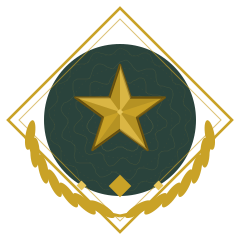
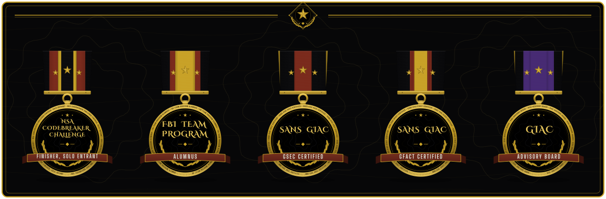
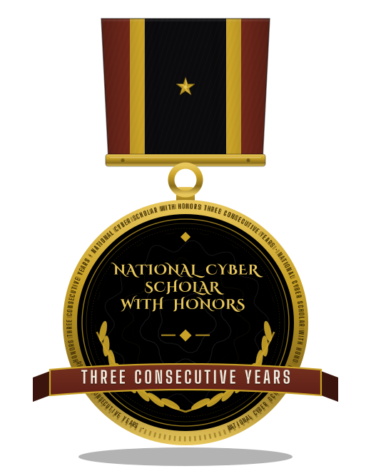
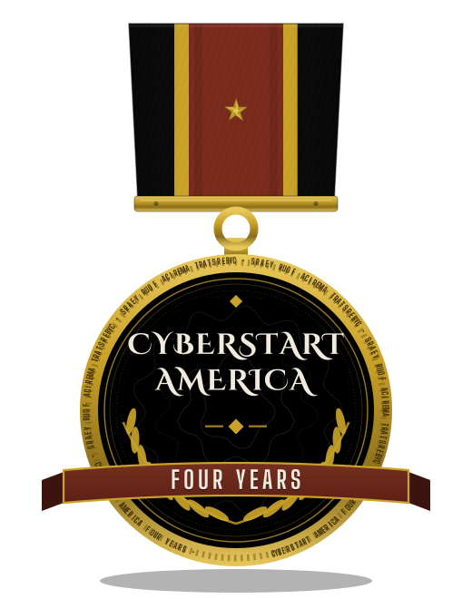
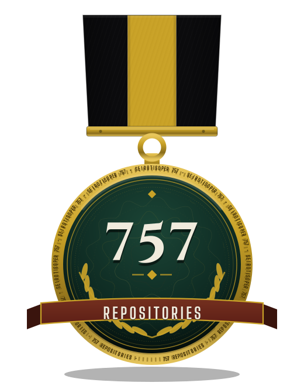

# Shatterpoint Security

**Boutique offensive security, in formation.**

Shatterpoint Security is a founder-led offensive-security practice built around one idea: every system has a point where pressure tells the truth. We find that point before someone else does.

**Focus**

- Penetration testing
- Red team operations
- AI / LLM security testing

**Status:** In formation. Research, tooling, and methodology are developed here ahead of launch.

Founded by Gavin Blacklock ([@Epsilon0xCell](https://github.com/Epsilon0xCell)).

## The Evidence

| Measure | Count |
|---|---|
| Repositories in the fleet | 757 |
| Audited line by line | 754 |
| Live secrets found | 0 |
| Practice areas | 3 |

The practice, in short: security reviews, tooling audits, and research, carried out on a public record and written in plain language.

## The Elite Row

Every claim here can be checked against the public record.

## The Record

  

